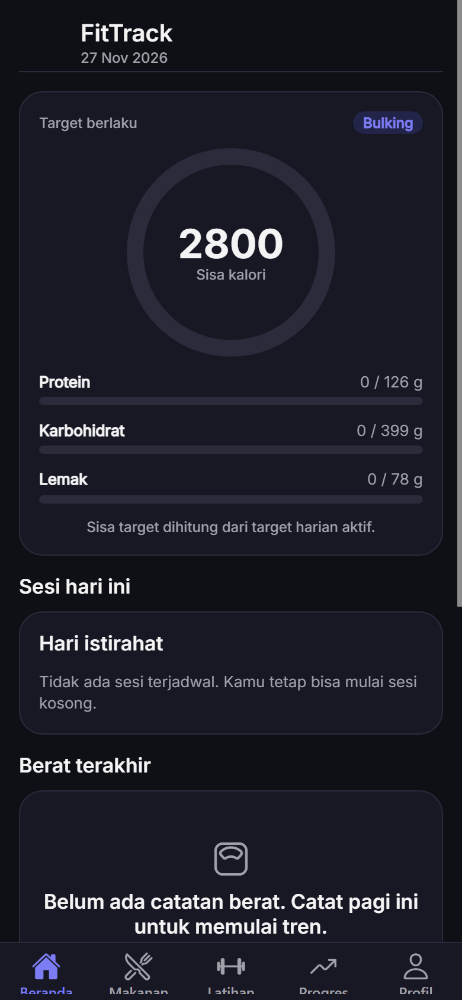
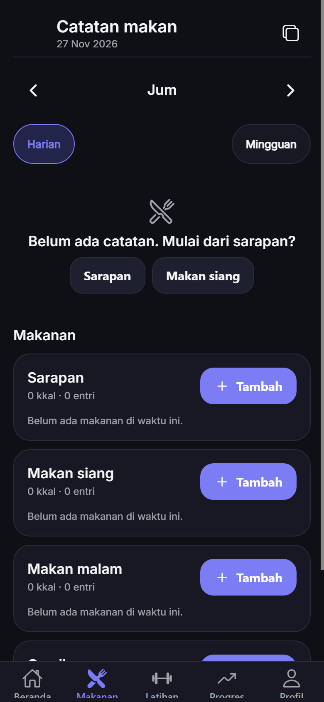
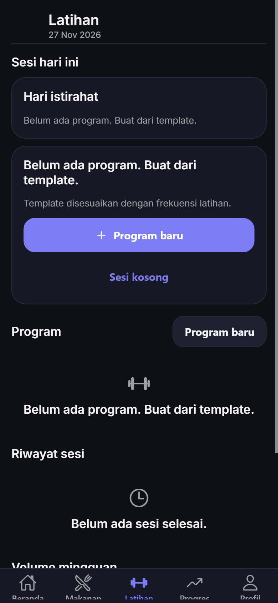
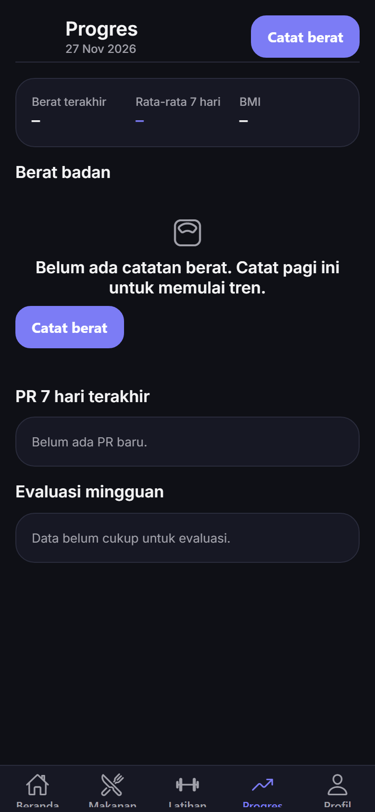
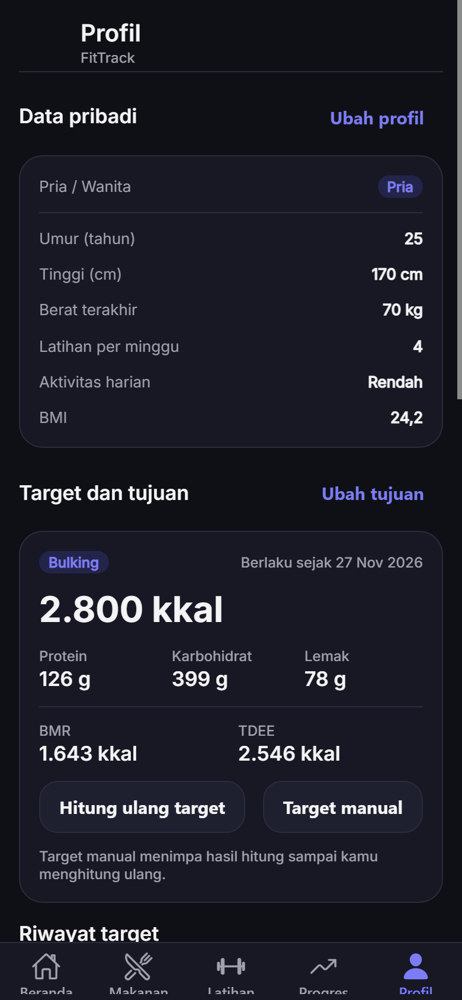

# FitTrack

An offline-first mobile fitness and nutrition tracker built with Expo and React Native. FitTrack combines daily calorie and macro tracking with gym workout logging and progressive overload guidance in a single connected application.

## Overview

Most fitness apps focus on either nutrition or strength training in isolation. FitTrack links both together: your training frequency feeds directly into your Total Daily Energy Expenditure (TDEE), your body weight trends inform weekly calorie adjustments, and your previous gym sessions drive progressive overload recommendations.

## Screenshots

| Home Dashboard | Food Log | Workout | Progress | Profile & Targets |
| :---: | :---: | :---: | :---: | :---: |
|  |  |  |  |  |

## Key Features

### Nutrition and Calorie Planning
- **Automatic BMR, TDEE, and Macro Targets:** Calculates Basal Metabolic Rate using Mifflin-St Jeor, Physical Activity Level (PAL) from daily activity and weekly training sessions, and macro splits for bulking, cutting, or body recomposition.
- **Safety Guardrails:** Enforces safe calorie floors and pace limits based on BMI and body weight, with transparent formula breakdowns and manual override support.
- **Indonesian Food Database:** Includes a seeded offline food catalog (1,300+ items based on TKPI 2020) with quick category filters, custom food creation, and meal-by-meal logging (breakfast, lunch, dinner, snacks).

### Workout and Progressive Overload
- **Program Templates and Custom Splits:** Create training programs from built-in templates or customize your own days and exercises.
- **Live Session Logging:** View previous session weights and reps inline while logging sets, with automatic estimated 1RM (e1RM) calculation, double-progression suggestions, and Personal Record (PR) detection.
- **Weekly Volume Tracking:** Summarizes completed sessions and weekly training volume.

### Progress and Offline Storage
- **Weight Trend and Weekly Evaluation:** Log daily body weight, monitor 7-day rolling averages and BMI, and review weekly calorie adjustment suggestions.
- **Offline-First Architecture:** All data is stored locally using SQLite (`expo-sqlite` + Drizzle ORM) on native devices, with JSON backup export/import and a `localStorage`-backed fallback for web preview.

## Tech Stack

- **Framework:** Expo (SDK 58), React Native 0.88, React 19
- **Navigation:** Expo Router (file-based routing under `src/app/`)
- **Language & Validation:** TypeScript, Zod, React Hook Form
- **State & Storage:** Zustand, `expo-sqlite`, Drizzle ORM
- **UI & Charts:** Custom dark/light theme system, `@expo/vector-icons`, `react-native-gifted-charts`, `react-native-reanimated`
- **Testing & Quality:** Jest (`jest-expo`), ESLint (`eslint-config-expo`), TypeScript (`tsc --noEmit`)

## Project Structure

```text
src/
├── app/            # Expo Router screens and tab navigation
├── data/           # Seeded exercises, foods, and workout templates
├── db/             # SQLite setup, schema, migrations, backup, and repositories
├── domain/         # Pure domain logic (nutrition, progression, weekly evaluation, dates)
├── state/          # Zustand UI state
└── ui/             # Theme tokens and reusable UI components
__tests__/          # Unit tests for domain logic and seed data integrity
docs/               # Progress notes and screenshots
```

## Getting Started

### Prerequisites

- Node.js 20+
- npm
- Expo Go or an Android/iOS development build (or a modern browser for web preview)

### Installation

```bash
npm install
```

### Running the App

```bash
# Start Expo dev server
npm start

# Run in web browser
npm run web

# Build and run on Android / iOS
npm run android
npm run ios
```

### Verification Commands

```bash
npm run typecheck   # TypeScript check (tsc --noEmit)
npm run lint        # Expo ESLint check
npm test            # Run Jest unit tests
```

### Building with EAS

Build profiles (`development`, `preview`, `production`) are configured in `eas.json`:

```bash
npx eas-cli@latest build --profile preview --platform android
```

## Disclaimer

FitTrack is a personal tracking and estimation tool and is not a substitute for professional medical or nutritional advice. Calorie and macro targets are estimates based on standard population formulas.
